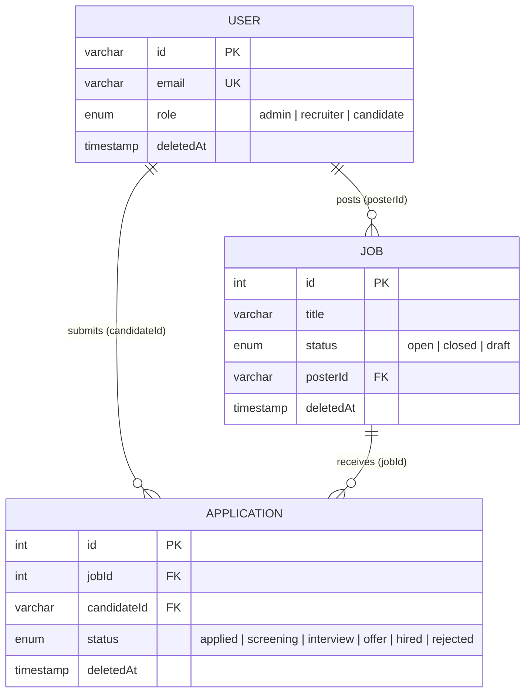
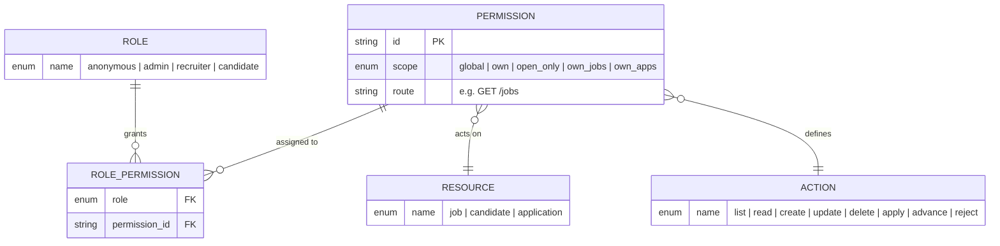
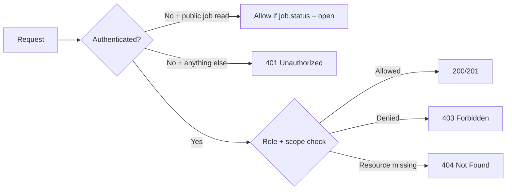

# Role-based authorization with ownership scoping

Authorization builds on Auth.js sessions from ADR 0003. Authentication (`verifyAuth`)
establishes identity; authorization middleware checks **role** (`admin`, `recruiter`,
`candidate`) and **resource ownership** before handlers execute. Anonymous users get
read-only access to open job listings; everything else requires a session.

## Data model and ownership

Authorization scopes attach to existing tables from ADR 0001:

**Ownership chains used for scoped access:**

- Recruiter scope on jobs: `job.posterId = user.id`
- Recruiter scope on applications: `application.job.posterId = user.id`
- Candidate scope on applications: `application.candidateId = user.id`

## RBAC model

Roles, resources, and actions map to route permissions:

## Access flow by role

```mermaid
flowchart TB
    subgraph Jobs
        J1["GET /jobs, GET /jobs/:id"]
        J2["POST /jobs"]
        J3["PUT /jobs/:id"]
        J4["DELETE /jobs/:id"]
    end

    subgraph Candidates
        C1["GET /candidates, GET /candidates/:id"]
        C2["POST /candidates"]
        C3["PUT /candidates/:id"]
        C4["DELETE /candidates/:id"]
    end

    subgraph Applications
        A1["GET /applications"]
        A2["POST /applications"]
        A3["POST /applications/:id/next-stage"]
        A4["POST /applications/:id/reject"]
    end

    ANON["anonymous"] -->|"scope: open_only"| J1

    ADMIN["admin"] -->|"scope: global"| J1 & J2 & J3 & J4
    ADMIN --> C1 & C2 & C3 & C4
    ADMIN --> A1 & A3 & A4

    REC["recruiter"] -->|"scope: own + open"| J1
    REC -->|"posterId = self"| J2
    REC -->|"scope: own"| J3 & J4
    REC -->|"scope: global (read only)"| C1
    REC -->|"scope: own_jobs"| A1 & A3 & A4

    CAND["candidate"] -->|"scope: open_only"| J1
    CAND -->|"scope: own_apps"| A1
    CAND -->|"scope: open jobs"| A2
```

## Permission matrix

### Jobs

| Permission | Anonymous | Admin | Recruiter | Candidate |
|------------|-----------|-------|-----------|-----------|
| `GET /jobs` (list) | open only | all | own (any status) + others' open | open only |
| `GET /jobs/:id` (read) | open only | any | own (any status) or open | open only |
| `POST /jobs` (create) | — | ✓ (can set `posterId`) | ✓ (`posterId` forced to self) | ✗ |
| `PUT /jobs/:id` (update) | — | any job | own jobs only | ✗ |
| `DELETE /jobs/:id` (delete) | — | any job | own jobs only | ✗ |

### Candidates

| Permission | Admin | Recruiter | Candidate |
|------------|-------|-----------|-----------|
| `GET /candidates` (list) | ✓ | ✓ | ✗ |
| `GET /candidates/:id` (read) | ✓ | ✓ | ✗ |
| `POST /candidates` (create) | ✓ | ✗ | ✗ |
| `PUT /candidates/:id` (update) | ✓ | ✗ | ✗ |
| `DELETE /candidates/:id` (delete) | ✓ | ✗ | ✗ |

### Applications

| Permission | Admin | Recruiter | Candidate |
|------------|-------|-----------|-----------|
| `GET /applications` (list) | all | own jobs' apps | own apps only |
| `POST /applications` (apply) | ✗ | ✗ | ✓ (open jobs only) |
| `POST /applications/:id/next-stage` | any | own jobs' apps | ✗ |
| `POST /applications/:id/reject` | any | own jobs' apps | ✗ |

## Cross-cutting rules

| Rule | Decision |
|------|----------|
| Public access | `GET /jobs` and `GET /jobs/:id` for `status = open` only |
| Auth required | All other routes |
| Job create ownership | Recruiter: `posterId` auto-set to self (body value ignored); Admin: may set any `posterId` |
| Candidate management | Recruiter: read only (`GET`); Admin: full CRUD |
| Authz failure | `403 Forbidden` |
| Missing resource | `404 Not Found` (only when truly absent or soft-deleted) |

## Considered Options

- **Fully authenticated API (no public reads)** — rejected; job boards typically allow
  browsing open listings without sign-in.
- **Recruiters can update/delete any job** — rejected; recruiters should only manage their
  own listings; admins retain global access.
- **Candidates can list/view other candidates** — rejected; candidate PII is visible to
  recruiters and admins only.
- **Recruiters can create/update/delete candidates** — rejected; candidate accounts are
  user records, so mutations are an admin concern; recruiters only need read access to
  evaluate applicants.
- **404 for ownership failures** — rejected; `403 Forbidden` is clearer for API clients
  when the resource exists but the user lacks access.
- **Client-supplied `posterId` for recruiters** — rejected; auto-assign from session to
  prevent ownership spoofing.

## Consequences

- Add authorization middleware on top of `verifyAuth()`: load user role from DB, enforce
  per-route permission matrix, and apply ownership checks via `posterId` / `candidateId`.
- Register public job read routes before auth middleware; all other routes require a session.
- On `POST /jobs`, set `posterId` from session for recruiters; allow admin override.
- On `POST /applications`, validate `job.status = open` before accepting.
- Scope `GET /applications` by role: admin (all), recruiter (own jobs), candidate (own apps).
- Candidate writes (`POST`/`PUT`/`DELETE /candidates`) are admin-only; recruiters can read
  candidates but get `403` on writes.
- Return `403` for authorization failures; reserve `404` for missing or soft-deleted resources.
- Extend route tests (ADR 0002) with session cookies per role and assert 401/403/404 behavior.
